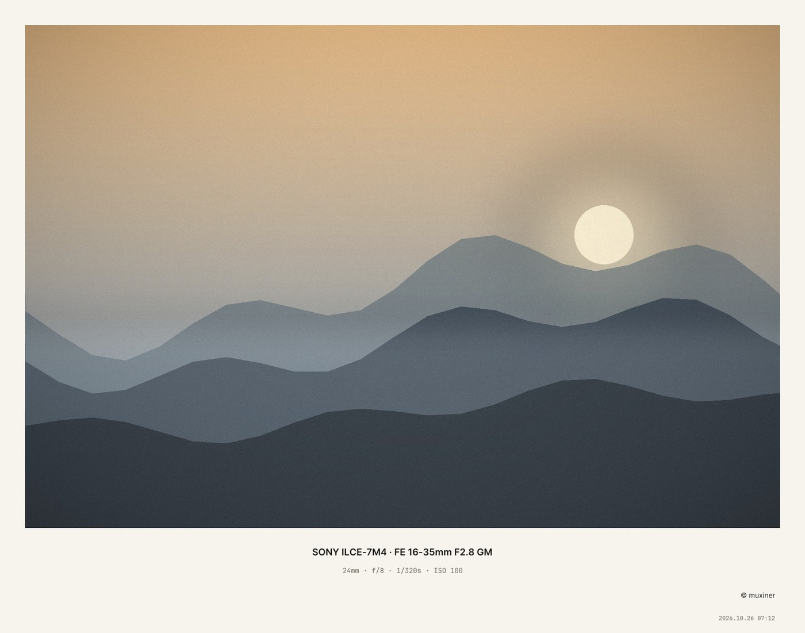
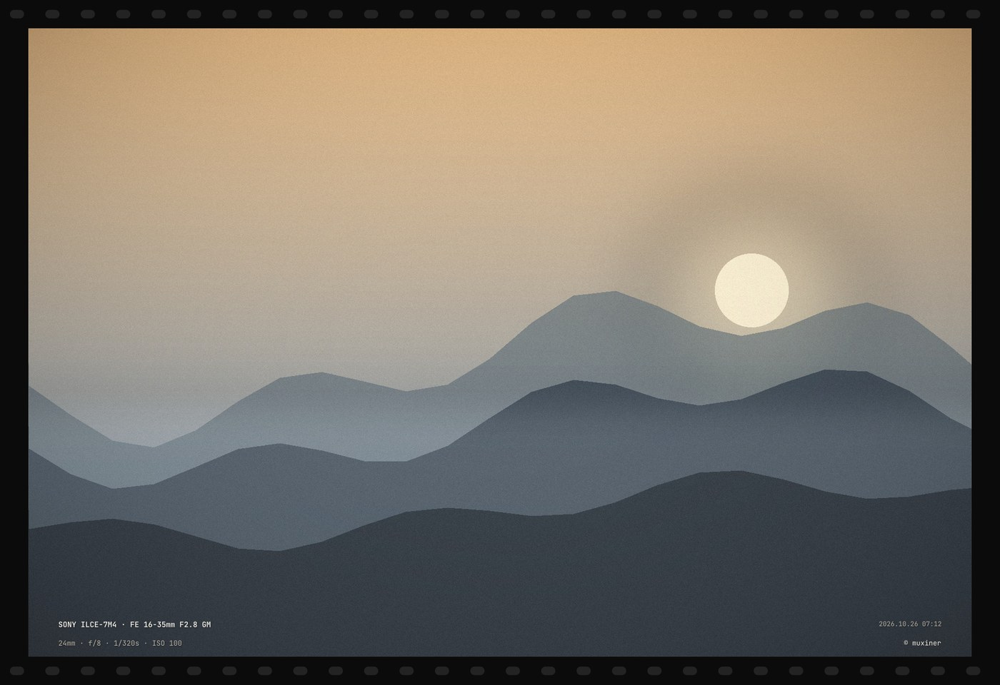
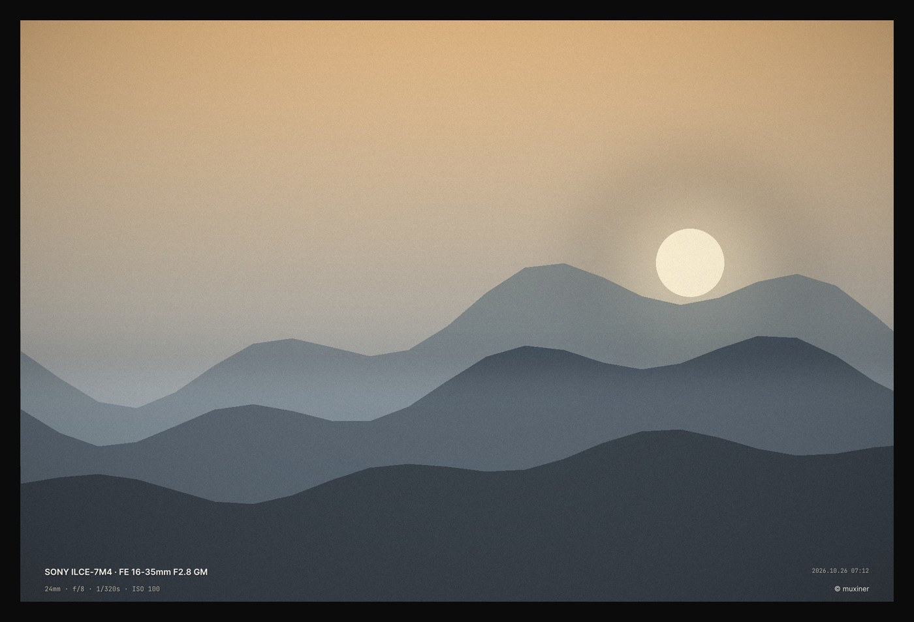
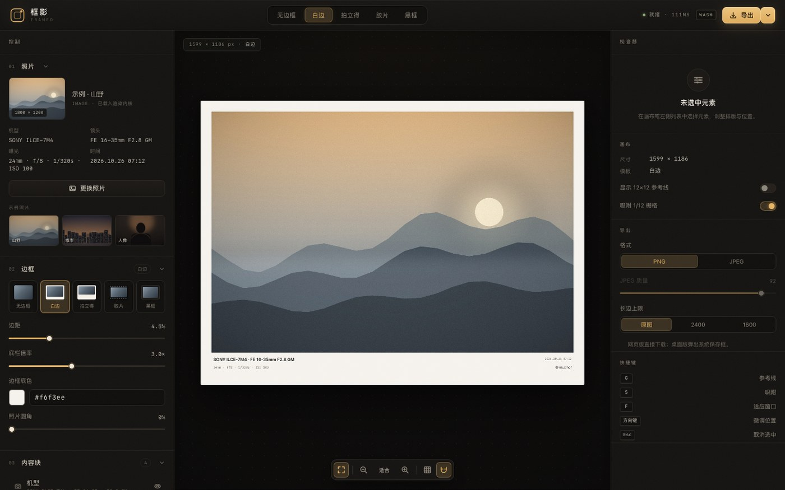
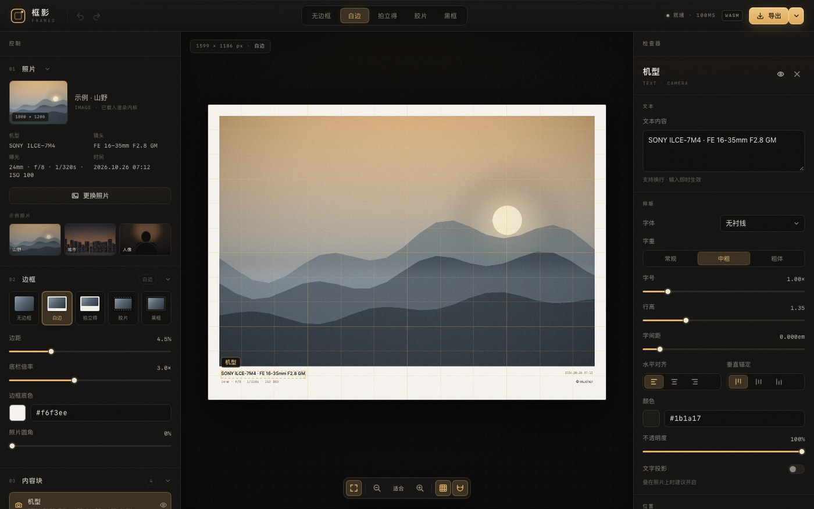
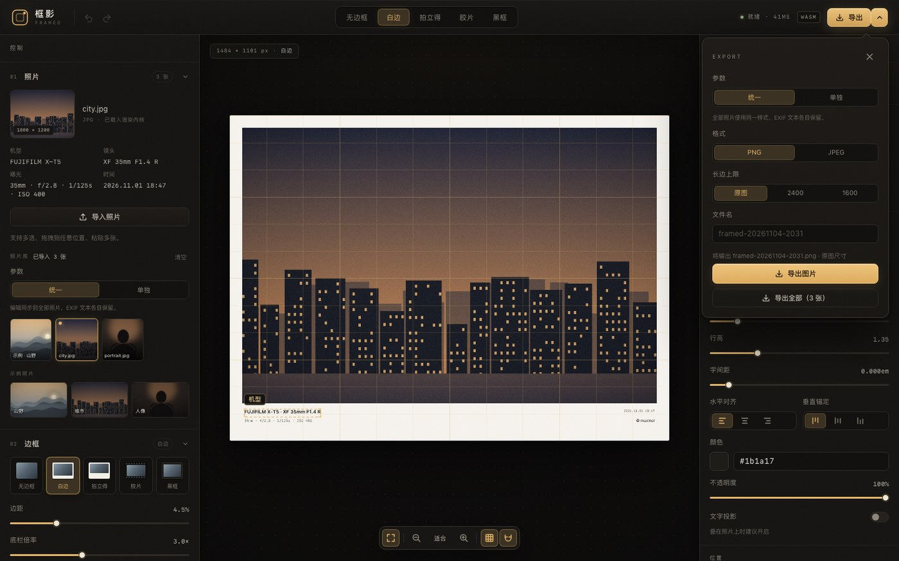
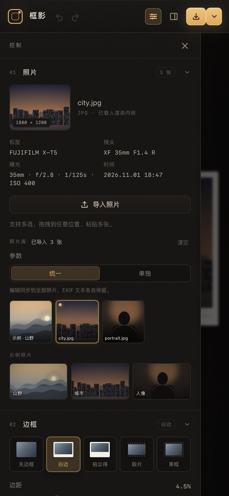
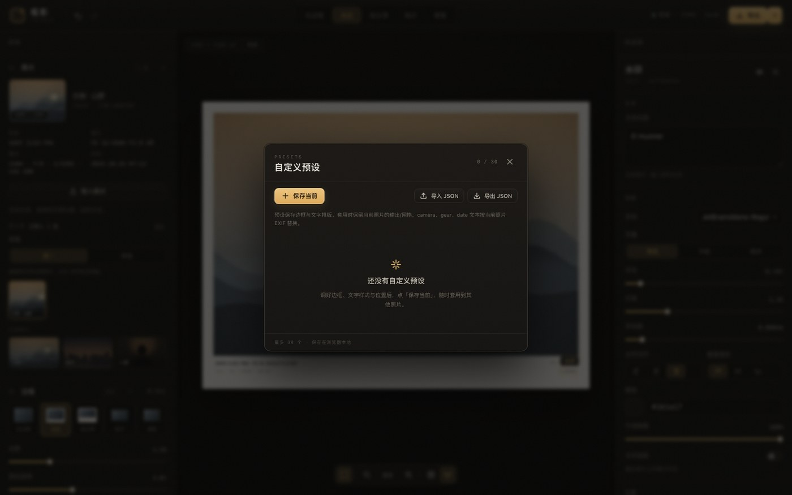
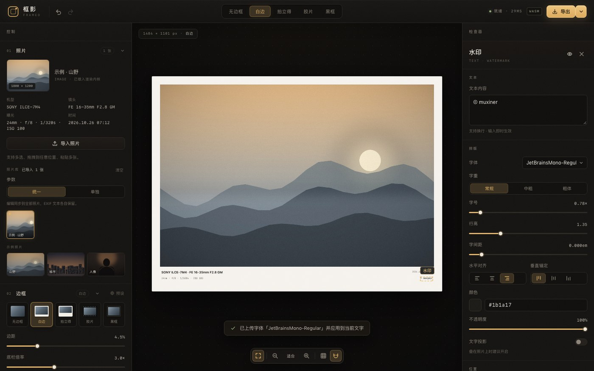

# 框影 · Framed

> 把照片装进相机取景框：**边框 + 拍摄参数 + 文字/Logo 水印**，12 栅格排版，实时预览，一键导出。
> Rust 内核一次实现，同时编译成 **WebAssembly（网页）** 与 **原生（Tauri 桌面 / CLI）**。


## 它是什么

旅行回来，照片好看，但总觉得少了点「作品感」。框影把相机取景框的那套仪式感搬过来：

- 自动读取 **EXIF**：机型、镜头、焦距、光圈、快门、ISO、拍摄时间；
- **多图导入**：直接拖入一张或多张照片（也支持文件多选 / 粘贴），左栏照片库切换、逐张保留编辑；
- **批量参数**：默认「统一」——改一次参数同步到全部照片（机型/参数/日期等 EXIF 文本仍各图保留）；可切「单独」逐张微调，或一键把当前参数应用到全部；
- **自定义预设**：把调好的边框 + 文字样式 + 位置保存成预设，随时套用；支持导出/导入 JSON；
- **自定义字体**：上传 ttf/otf 用在文字块上（网页端持久化，桌面端当前进程内有效）；
- **批量导出**：一次导出全部照片（桌面端选目录写入，网页端逐张下载）；
- 给照片加**边框**（白边 / 拍立得 / 胶片 / 黑框 / 无边框），参数排进留白里；
- 文字与参数**逐项可编辑**：内容、字体、字号、字重、颜色、透明度、字间距、对齐、阴影；
- 位置用 **12 等分栅格**：12×12 网格、吸附网格线、9 宫格预设、画布上直接拖拽；
- 支持 **Logo 水印**（上传 PNG）；
- **完整编辑历史**：撤销 / 重做（`⌘/Ctrl+Z`、`⇧⌘Z` / `Ctrl+Y`），拖拽、连续输入、滑杆拖动自动合并成一步；
- 导出 **PNG / JPEG**，可设长边与质量；
- **同一套 Rust 内核**：网页用 wasm、桌面用原生 Tauri、命令行用原生可执行文件，三端构图逐像素一致。

## 模板

| 白边 | 拍立得 | 胶片 |
| --- | --- | --- |
|  |  |  |

| 黑框 | 无边框 |
| --- | --- |
|  |  |

## 界面



三栏布局：左侧「照片 / 照片库 / 参数模式 / 边框 / 内容块」，中间画布，右侧检查器（画布 / 导出 / 快捷键，选中元素后变为排版参数 + 12×12 定位器）。

| 12 栅格 + 选中块检查器 | 批量导出 | 窄屏（390px） |
| --- | --- | --- |
|  |  |  |

| 自定义预设 | 自定义字体 |
| --- | --- |
|  |  |

- **照片库**：拖入一张或多张照片（也支持文件多选 / 粘贴多张）→ 左栏缩略图切换；
- **参数模式**：默认「统一」（编辑同步到全部照片，机型/参数/日期文本按各图 EXIF 保留）；切到「单独」后逐张微调，并可一键「应用当前参数到全部」；「导出全部」按当前模式批量出图；
- **预设**：调好的边框/字体/位置存成预设（localStorage，最多 30 个），随时套用、导出/导入 JSON；
- **自定义字体**：上传 ttf/otf 用于任意文字块，网页端 IndexedDB 持久化，缺字形自动回退内置字体；
- 画布支持缩放 / 适应窗口、12 栅格参考线、吸附开关；
- 拖拽文字块吸附到 1/12 网格（按住 Alt 临时关闭吸附），方向键 1/144 微调（Shift 1/12）；
- 快捷键：`⌘/Ctrl+Z` 撤销、`⇧⌘Z` / `Ctrl+Y` 重做、`G` 参考线、`S` 吸附、`F` 适应窗口、`Esc` 取消选中、`⌘/Ctrl+E` 导出。

## 架构

```
                      ┌────────────────────────────┐
                      │  crates/core（Rust 内核）   │
                      │  EXIF · 边框 · 文字光栅化    │
                      │  12 栅格布局 · PNG/JPEG 编码 │
                      └────────────┬───────────────┘
                                   │
             ┌─────────────────────┼──────────────────────┐
             │                     │                      │
   crates/wasm（C ABI）    crates/cli（原生 CLI）   apps/desktop（Tauri 命令）
             │                     │                      │
   apps/web（Vite + 原生 TS 编辑器，同一套 UI）
             │
   浏览器 / Tauri WebView
```

- **内核**：`crates/core` 不依赖任何平台 API，字体以子集形式内嵌（Inter / JetBrains Mono / Noto Sans SC 子集，约 4.6 MB）。
- **网页**：`crates/wasm` 手写 C ABI（不引入 wasm-bindgen），前端 `WebAssembly.instantiate` 后按 `[u32 json_len][json][u32 bin_len][bin]` 读取结果。
- **桌面**：Tauri v2，前端同一份 `apps/web/dist`，渲染走原生命令（图片只上传一次，之后只传配置）。
- **CLI**：`framed` 可执行文件，适合批处理与验收。

接口与配置字段的唯一权威说明见 [`docs/CONTRACT.md`](docs/CONTRACT.md)。

## 快速开始

### 网页版

```bash
# 1. 构建 wasm（需要 rustup target add wasm32-unknown-unknown）
./scripts/build-wasm.sh

# 2. 安装依赖并启动开发服务器
npm --prefix apps/web install
npm --prefix apps/web run dev          # http://localhost:5173

# 或构建静态站点
./scripts/build-web.sh                 # 产物在 apps/web/dist
```

### 桌面版（macOS / Windows / Linux）

```bash
npm --prefix apps/desktop install
./scripts/build-desktop.sh             # 产出 apps/desktop/src-tauri/target/release/bundle/macos/Framed.app
open apps/desktop/src-tauri/target/release/bundle/macos/Framed.app
```

桌面端渲染走原生 Rust（不加载 wasm），导出使用系统保存对话框。

### 命令行 / 原生可执行文件

```bash
cargo build --release -p framed-cli
./target/release/framed probe  photo.jpg
./target/release/framed render photo.jpg -t film -o framed.jpg
./target/release/framed demo   photo.jpg --out-dir /tmp/demo   # 一次渲染 5 个模板
```

`framed render` 支持 `-t/--template`、`-c/--config`（自定义 RenderConfig JSON）、`--max-dim`、`--margin`、`--watermark`、`--jpeg`、`--quality`。

## 预览性能

改字号、拖位置、调边距时，预览不会再等一两秒：

- 照片在载入/切换时**只解码、转正、缩放一次**（wasm 与桌面端各自缓存预览底图，长边 1400）；
- 之后每次改参数只重新合成边框/文字/Logo，并以 JPEG(q90) 返回预览位图；
- 全尺寸导出时才重新解码原图。
- 实测（Apple Silicon / Chromium）：24 MP 照片预览单帧约 **40–60 ms**（优化前约 400–900 ms），编辑基本无感。

## 12 等分栅格怎么用

成品画布（含边框）被 12×12 等分为网格：

- 拖动文字块时自动吸附到最近的 `1/12` 格线（可关闭吸附）；
- 右侧检查器有 **144 格定位器**，点哪一格，文字锚点就落在哪；
- 9 宫格预设一键摆到左上 / 上中 / 右上 / 左中 / 居中 / 右中 / 左下 / 下中 / 右下；
- `x / y` 仍可数值微调，`align / alignY` 决定文字相对锚点的伸展方向。

配置里的坐标全部是 `0..1` 的归一化值，因此同一份配置在任意分辨率、任意端上构图一致。

## 配置示例

```json
{
  "version": 1,
  "frame": {
    "template": "white",
    "margin": 0.045,
    "bottomRatio": 3.0,
    "background": "#f6f3ee",
    "radius": 0,
    "filmHoles": true
  },
  "blocks": [
    {
      "type": "text",
      "id": "camera",
      "name": "机型",
      "text": "SONY ILCE-7M4 · FE 16-35mm F2.8 GM",
      "x": 0.03, "y": 0.9,
      "align": "left", "alignY": "top",
      "font": "sans", "weight": 600, "size": 1.0,
      "lineHeight": 1.35, "letterSpacing": 0,
      "color": "#1b1a17", "opacity": 1, "visible": true, "shadow": false
    }
  ],
  "grid": { "columns": 12, "rows": 12, "snap": true, "visible": false },
  "output": { "format": "png", "quality": 92, "maxDim": 0 }
}
```

## 项目结构

```
framed/
├── crates/
│   ├── core/          # 渲染内核（EXIF、边框、文字、布局、编码）+ 内嵌字体
│   ├── cli/           # `framed` 命令行
│   └── wasm/          # wasm32 cdylib，手写 C ABI
├── apps/
│   ├── web/           # Vite + 原生 TS 编辑器（网页 & Tauri 共用）
│   └── desktop/       # Tauri v2 桌面壳（独立 cargo 工程）
├── apps/web/public/samples/  # 示例照片（合成，带 EXIF）
├── docs/CONTRACT.md   # 跨端契约（配置 schema / ABI / 命令 / UI 规范）
├── scripts/           # wasm / web / desktop 构建，字体子集化，示例图生成
└── AGENTS.md          # 给 AI 协作者的项目说明
```

## 开发

```bash
cargo test -p framed-core            # 内核单测（EXIF、混合、排版、渲染）
cargo run -p framed-cli -- --help
npm --prefix apps/web run typecheck
npm --prefix apps/web run build
npm --prefix apps/desktop run tauri dev
```

重新生成内嵌字体（改字符集时）：

```bash
python3 -m pip install fonttools
PYTHONPATH=<fonttools> python3 scripts/build_fonts.py
```

重新生成示例照片：

```bash
python3 scripts/make_samples.py     # 需要 Pillow + numpy
```

> 中国大陆网络下，仓库内 `.cargo/config.toml` 已配置 rsproxy 镜像；npm 建议 `--registry=https://registry.npmmirror.com`。

## 字体许可

内嵌字体均为 SIL Open Font License 1.1，随包附带授权文本：

- Inter — © The Inter Project Authors
- JetBrains Mono — © JetBrains s.r.o.
- Noto Sans SC — © Adobe / Google（Source Han Sans 系列）

## 状态与路线图

- [x] Rust 内核：EXIF、5 种边框、文字/Logo 水印、12 栅格、PNG/JPEG
- [x] WebAssembly 网页版 + 网页编辑器
- [x] 撤销 / 重做（40 步历史，拖拽 / 输入 / 滑杆自动合并）
- [x] 批量参数：默认统一 / 可切单独调整
- [x] 自定义预设（保存 / 套用 / 导出导入 JSON）
- [x] 自定义字体上传（ttf / otf，≤8MB）
- [x] 照片库拖拽排序（鼠标 / 触摸长按，Alt+←/→ 键盘移动）
- [x] Tauri v2 桌面版（原生渲染、系统保存对话框）
- [x] 原生 CLI（批量渲染）
- [ ] RAW（CR3/NEF/ARW）解码与缩略图
- [ ] 预设云端同步 / 分享
- [ ] 移动端（iOS / Android）

## License

MIT © 2026 muxiner
